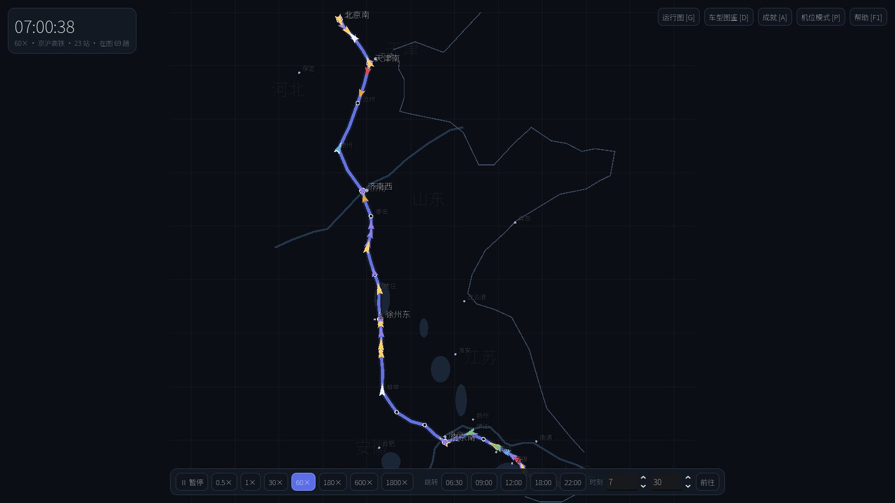
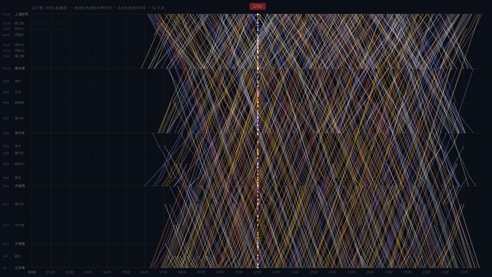
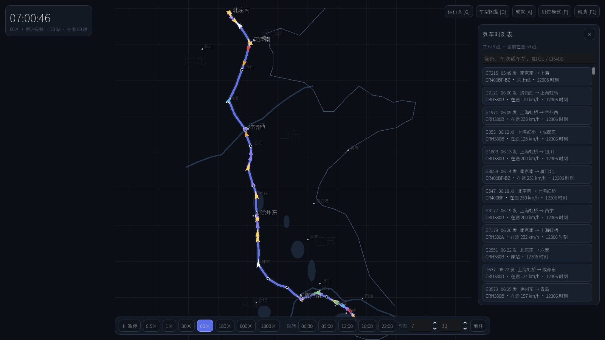
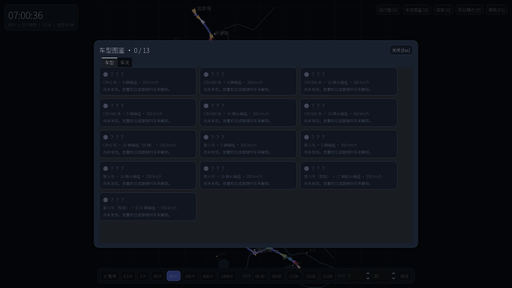

# 观车·京沪 RailWatch Jinghu

一个基于**真实地理**与 **12306 真实时刻表**的铁路列车观测探索游戏（Godot 4）。
当前已接入 **65 条线路 · 740 座车站 · 7200+ 趟真实车次**（其中跨线直达车 3400+ 趟按真实路径多线接力运行），并按速度等级分类展示（可在地图左侧图例中开关显隐）：

- **350km/h 主干**：京沪、京广、沪昆、京哈、京津、成渝、济郑、郑渝、沪苏湖、京张—呼
- **200-250km/h**：哈大、徐兰、杭深、沿江、西成、贵广、兰新、济青、宁杭、合福、商合杭、京港、大西、西银、郑太、石济、津秦、哈佳、哈牡、宁安、日兰、连镇、徐盐—盐通、怀邵衡、张吉怀、渝贵
- **联络与区域线**：汉十、赣瑞龙、昌九、昌景黄、杭温、中兰（银兰）、常益长、黔常、南昆、昆楚大丽、哈齐、牡佳、长珲
- **城际**：沪宁、广珠、海南环岛（东段）
- **普速**：京沪线、京广线、京九线、陇海线、兰渝线、成昆线、青藏线、焦柳线、渝怀线

京沪高铁全线 23 座车站、约 1300 公里的 600+ 趟真实列车（车次、始发终到、
全部停站的到发时刻均来自 12306 公开查询接口）在地图上昼夜不停地运行。
你是一名车迷：缩放地图看哪里有什么车、点开任意列车看详情、跟随镜头陪一趟车
跑完全程、在地图上放置观测「机位」蹲点拍车——点亮车型图鉴、解锁成就。
还可以按 `G` 打开经典的**时刻-距离运行图**，几百条斜线铺满全屏。

| 全线鸟瞰 | 运行图（时刻-距离图） |
| --- | --- |
|  |  |

| 车次列表（真实跨线车） | 车型图鉴 |
| --- | --- |
|  |  |

## 特性

- **真实时刻表**：12306 公开接口抓取（2026-10-29 查询日），含大站直达车、
  多停区间车与跨线车（青岛→上海虹桥、成都东→上海虹桥动卧等，驶出本线后消失）
- **多线路 + 跨线续接**：36 条线路同屏分色；列车按真实路径**跨线连续运行**
  （如北京朝阳→大连北会从京哈线接入哈大线继续行驶，在联络站自动换线）
- **运行图**：纵轴真实公里标、横轴一昼夜；可切换线路，跨线车画出其在本线的区段
- **运行图视图**：纵轴真实公里标、横轴一昼夜、每趟车一条斜线；红色游标
  拖动平移时间，线上彩点为各车实时位置，点击斜线选中列车
- **实时仿真**：时刻表+梯形速度包络的纯函数解算，暂停/0.5×~1800× 变速/跳转任意时刻
- **观测与收集**：点击/跟随/机位自动捕捉 → 收录车型与车次
- **车型图鉴**：13 种动车组（CR400 各系、CRH380 各系、CRH2C、CRH2E 动卧），
  每种车型有程序化侧视图「模型图」；想用实拍图？把 PNG 放到
  `data/trains/images/<车型id>.png`（如 `CR400AF.png`）即可自动替换
- **15 个成就**：早高峰、夕发朝至、全程见证、一日千里、走遍沿线、同屏盛况……
- **进度持久化**：图鉴/成就/机位/时刻自动存档

## 运行方法

**方式一（推荐）：** 双击根目录的 **`启动游戏.bat`**——直接启动游戏（要求
`godot/` 目录下已有 Godot 4.4.1 引擎，见下方「引擎下载」）。

**方式二：** 安装 [Godot 4.3+](https://godotengine.org/download)（标准版），
打开 `project.godot`，按 **F5** 运行。

**引擎下载（国内网络）：** 从 GitHub 发布页下载
`Godot_v4.4.1-stable_win64.exe.zip` 并解压到 `godot/`；被墙时可用镜像前缀
`https://gh-proxy.com/<GitHub 原链接>`。

**操作**：左键拖拽/滚轮移动缩放地图；点击列车看详情；`F` 跟随、`Tab` 列表、
`G` 运行图、`P` 机位模式、`D` 图鉴、`A` 成就、`Space` 暂停、`F1` 帮助。

## 数据说明（重要）

- 车站坐标、线路里程为公开资料整理的近似值；线形为「站点连线 + 途经弯道点」
  的近似走向（可用 `tools/import_alignment.py` 一键替换为 OSM 真实线形）。
- **车次与到发时刻为 12306 真实数据**；12306 不公开车底（车型）信息，图鉴中
  的车型为按交路特征推测的标注，仅供参考。
- 京沪高铁 0:00–6:00 为天窗，真实无车。
- 本作与铁路运营方无关联，仅供游戏体验与学习。

### 时刻表更新 / 换个日期抓取

```bash
python tools/fetch_12306.py search > tools/cache12306/search.jsonl
python tools/fetch_12306.py index  > tools/cache12306/index.json
python tools/fetch_12306.py detail >> tools/cache12306/detail.jsonl
python tools/build_from_12306.py   > data/timetables/real.json
```

全部响应带磁盘缓存与断点续传，重跑只补抓缺失部分；改 `fetch_12306.py` 顶部
的 `DATE_*` 常量可抓取其他日期（周末与平日车次有差异）。限速抓取，请勿移除延时。

## 接入更多线路（路线图）

数据管线已按「线路」解耦，接入全国其他线路不需要改仿真与 UI 代码：

| 待接入 | 说明 |
| --- | --- |
| 京津城际 | 最短 fastest 起步线，检验管线复用 |
| 京沪既有线（普速） | 客车+货车混合车流，考验图鉴与速度分级 |
| 京广 / 沪昆 / 京哈高铁 | 长干线，跨线车极多，检验时刻表规模 |
| 济青、徐兰、宁杭等 feeder | 丰富跨线车的真实接入/驶离点 |

接入一条新线路的步骤：

1. 新建 `data/lines/<line_id>.json`：车站表（id/名称/经纬度/官方公里标/等级）+
   近似线形 geometry（或用 `tools/import_alignment.py` 从 OSM GeoJSON 生成）；
2. 在 `tools/build_from_12306.py` 中把「沿线 23 站过滤」参数化为本线车站集合
   （该车次 ≥2 站在本线即收录）；
3. 跑一遍 `fetch_12306.py`（全国枚举结果可复用缓存，只需重转）；
4. 多线并存时增加：多线路图层切换/同屏渲染、跨线车在「接入点离图 → 另一线路
   接图」的续接渲染、跨线路图鉴与成就统计。

## 项目结构

```
project.godot            Godot 4 项目配置（入口 src/main.tscn，4 个自动加载单例）
data/
  lines/jinghu_hsr.json      线路：23 站坐标/里程 + 近似线形折线
  map/background.json        底图：海岸线/长江/黄河/湖泊/省市标注（简化装饰）
  trains/train_types.json    车型图鉴库（13 种）
  timetables/real.json       12306 真实时刻表
  achievements.json          成就定义
src/
  autoload/                  DB（数据总线）/ GameTime / Simulation / Meta（观测·图鉴·成就·存档）
  core/geo.gd                经纬度 <-> 世界坐标投影
  map/                       地图渲染 / 标注层 / 相机 / 列车层 / 机位层
  ui/                        全部 UI（代码构建）：运行图 / 列表 / 详情卡 / 图鉴 / 成就 / 帮助
  main.gd                    主场景接线：点选/跟随/快捷键/交会检测/自动存档
tools/
  timetable_lib.py           共享库（弧长、时分推算、校验）
  fetch_12306.py             12306 抓取器（枚举 + 详情，JSONL 缓存续传）
  build_from_12306.py        缓存 -> 游戏时刻表转换与校验
  import_alignment.py        GeoJSON 真实线形导入器
docs/screenshots/           README 截图
```

## 技术要点

- **纯函数仿真**：列车状态只由「(车次, 时刻)」决定，任意倍速/跳转天然正确；
  跨午夜列车（动卧）以绝对秒 + 环形取模处理
- **屏幕空间文字标注层**：规避 Godot 世界字号超字形位图上限与 draw_string
  不支持画笔变换的限制，同时获得 LOD 与按车型着色的车次标注
- **约定式数据流**：抓取（缓存/续传/限速）→ 转换（校验/过滤）→ 运行时只读 JSON

## 后续计划

- [ ] OSM 真实线形默认替换近似线形
- [ ] 正晚点 / 突发事件模拟
- [ ] 时刻-距离图上直接拖动调整时刻的「排图」玩法
- [ ] 跨线路图鉴与全国路网视图

## 引擎与许可

- 引擎：Godot 4.4（MIT License）；字体：思源黑体（SIL OFL）
- 游戏代码与数据整理：随项目分发，学习用途欢迎参考；时刻表数据版权归
  中国国家铁路集团有限公司所有，请勿用于商业用途
